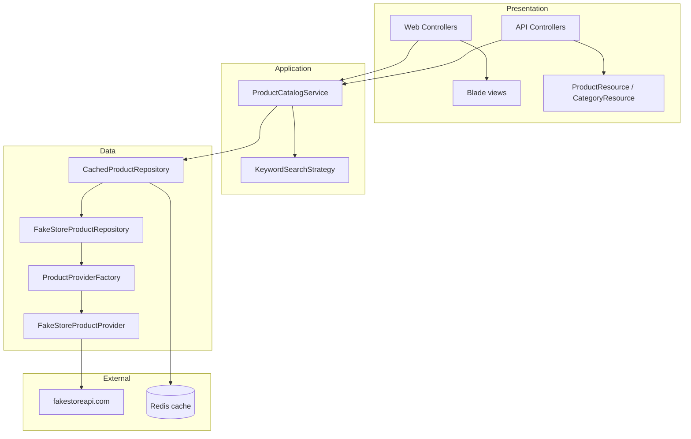
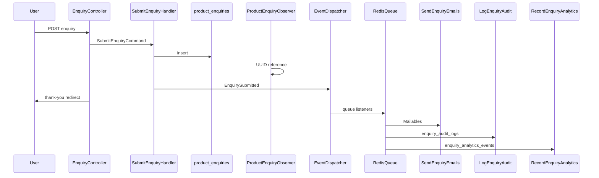

# Product Catalogue Application

**First time setup (clone & run locally):** [LOCAL_SETUP.md](LOCAL_SETUP.md)

Laravel 12 application that browses products from the [Fake Store API](https://fakestoreapi.com), with category filtering, keyword search, Redis-backed caching, product enquiries, and both Blade pages and JSON API endpoints.

## Ticket 1: Product Catalog & Search

### Acceptance criteria

| Requirement | Status |
|-------------|--------|
| Home page shows top 5 featured products | Top 5 by `rating` (highest first) |
| Browse products by category | Web + API |
| Search products by keyword | Title, description, and category |
| Product details: image, title, description, category, price | Web + API |
| Data via service layer | `ProductCatalogService` |
| DTOs and API Resource transformers | `ProductDTO`, `ProductResource` |
| Redis caching | `CachedProductRepository` |

## Architecture



## Folder map

```
app/
  Contracts/          # Provider, repository, search strategy interfaces
  DTOs/               # ProductDTO, CategoryDTO
  Factories/          # ProductProviderFactory (Factory pattern)
  Providers/FakeStore # HTTP integration (provider abstraction)
  Repositories/       # FakeStore + Redis decorator (Repository pattern)
  Search/             # KeywordSearchStrategy (Strategy pattern)
  Services/           # ProductCatalogService (service layer)
  Http/Controllers/   # Web + Api controllers
  Http/Resources/     # JSON transformers
config/catalog.php    # Provider URL, cache TTL, featured limit
```

## Design patterns

| Pattern | Implementation |
|---------|----------------|
| Repository | `ProductRepositoryInterface`, `FakeStoreProductRepository` |
| Service layer | `ProductCatalogService` |
| Factory | `ProductProviderFactory` → `FakeStoreProductProvider` |
| Strategy | `KeywordSearchStrategy` implements `ProductSearchStrategyInterface` |
| DTO | `ProductDTO`, `CategoryDTO` |
| Dependency injection | Bindings in `AppServiceProvider` |
| Redis cache | `CachedProductRepository` decorates the HTTP repository |

## Request flow

1. Route hits a Web or API controller.
2. Controller calls `ProductCatalogService` only (no direct HTTP).
3. Service uses `ProductRepositoryInterface` (cached decorator).
4. Cache miss → `FakeStoreProductRepository` → `ProductProviderInterface`.
5. `FakeStoreProductProvider` calls Fake Store API; responses become DTOs.
6. API responses pass through `ProductResource` / `CategoryResource`.

## Fake Store API usage

| Method | Fake Store endpoint | App usage |
|--------|---------------------|-----------|
| All products | `GET /products` | Listing, search base, featured sort |
| Categories | `GET /products/categories` | Nav + API |
| By category | `GET /products/category/{name}` | Category browse |
| Single product | `GET /products/{id}` | Detail page |

DTO mapping (`ProductDTO::fromArray`):

- `id`, `title`, `price`, `description`, `category`, `image`
- `rating` ← `rating.rate` when present

**Featured products:** the API has no featured flag; this app takes the **5 highest-rated** products from the full catalog.

**Search:** Fake Store has no search endpoint; `KeywordSearchStrategy` filters the cached full product list client-side in PHP.

## Caching

`CachedProductRepository` stores serialized DTO arrays in Redis:

| Key | Content |
|-----|---------|
| `catalog:products:all` | All products |
| `catalog:categories` | Category slugs |
| `catalog:products:category:{md5}` | Products in one category |
| `catalog:products:id:{id}` | Single product (null if missing) |

TTL: `CATALOG_CACHE_TTL` (default `3600` seconds).

### Redis on Windows (XAMPP)

1. Install Redis (e.g. [Memurai](https://www.memurai.com/) or WSL Redis) on `127.0.0.1:6379`.
2. In `.env`:
   ```env
   CACHE_STORE=redis
   REDIS_CLIENT=predis
   REDIS_HOST=127.0.0.1
   REDIS_PORT=6379
   ```
3. `predis/predis` is included for Windows where the `phpredis` extension is unavailable.

## Setup

```bash
composer install
cp .env.example .env   # Windows: copy .env.example .env
php artisan key:generate
# Start Redis, then:
php artisan serve
```

Frontend assets (optional for dev):

```bash
npm install
npm run dev
```

### Sample URLs

| Page | URL |
|------|-----|
| Home (featured) | http://127.0.0.1:8000/ |
| All products | http://127.0.0.1:8000/products |
| Search | http://127.0.0.1:8000/products?q=shirt |
| Category | http://127.0.0.1:8000/products/category/electronics |
| Product detail | http://127.0.0.1:8000/products/1 |

| API | URL |
|-----|-----|
| Featured | GET `/api/products/featured` |
| List / search | GET `/api/products?q=keyboard` |
| Show | GET `/api/products/{id}` |
| Categories | GET `/api/categories` |
| Category products | GET `/api/categories/{category}/products` |

## Environment variables

| Variable | Default | Purpose |
|----------|---------|---------|
| `CACHE_STORE` | `redis` | Must be `redis` for ticket caching |
| `REDIS_CLIENT` | `predis` | Redis driver client |
| `REDIS_HOST` | `127.0.0.1` | Redis host |
| `REDIS_PORT` | `6379` | Redis port |
| `CATALOG_PROVIDER` | `fakestore` | Provider key for factory |
| `FAKESTORE_BASE_URL` | `https://fakestoreapi.com` | API base URL |
| `CATALOG_CACHE_TTL` | `3600` | Cache lifetime (seconds) |
| `CATALOG_FEATURED_LIMIT` | `5` | Featured product count |

## Testing

Tests fake HTTP with `Http::fake` and use the `array` cache driver (see `phpunit.xml`).

```bash
php artisan test
```

---

# Ticket 2: Product Enquiry & Event-Driven Processing

Customers can submit enquiries from a product detail page. The write path uses a CQRS-style command handler; side effects (email, audit, analytics) run asynchronously via queued event listeners on Redis.

## Acceptance criteria

| Requirement | Implementation |
|-------------|----------------|
| Submit name, email, phone, message | Form on `products/show` → `POST /products/{id}/enquiries` |
| Validation | `StoreEnquiryRequest` |
| Enquiry stored in database | `product_enquiries` + `SubmitEnquiryHandler` |
| Thank-you page | `GET /enquiries/thank-you/{reference}` |
| Email notifications async | `SendEnquiryNotificationListener` (queued) |
| Audit & analytics via events | `LogEnquiryAuditListener`, `RecordEnquiryAnalyticsListener` |

## Flow



## Layout

```
app/
  Enquiries/Commands/     # CQRS write: SubmitEnquiryCommand, SubmitEnquiryHandler
  Events/EnquirySubmitted.php
  Listeners/              # Queued: mail, audit, analytics
  Observers/ProductEnquiryObserver.php
  Mail/                   # EnquiryReceivedMail, EnquiryAdminMail
  Models/                 # ProductEnquiry, EnquiryAuditLog, EnquiryAnalyticsEvent
config/enquiry.php
```

## Patterns

| Pattern | Where |
|---------|--------|
| Observer | `ProductEnquiryObserver` (reference + status on create) |
| Event-driven | `EnquirySubmitted` + three listeners |
| Queue | `ShouldQueue` listeners, `QUEUE_CONNECTION=redis` |
| CQRS foundation | Command handler for writes; thank-you reads Eloquent directly |
| Redis | Queue backend (same Redis as cache) |

## Routes

| Method | Path | Name |
|--------|------|------|
| POST | `/products/{id}/enquiries` | `enquiries.store` |
| GET | `/enquiries/thank-you/{reference}` | `enquiries.thank-you` |

## Queue worker (local)

Enquiries are saved immediately; emails, audit rows, and analytics run on the queue. With Redis running:

```bash
php artisan queue:work redis
```

Or use `composer dev`, which starts a queue worker using `QUEUE_CONNECTION` from `.env`.

For local mail debugging, set `MAIL_MAILER=log` and inspect `storage/logs/laravel.log` after the worker processes jobs.

## Environment variables (enquiry)

| Variable | Default | Purpose |
|----------|---------|---------|
| `QUEUE_CONNECTION` | `redis` | Async listeners |
| `ENQUIRY_QUEUE_CONNECTION` | `${QUEUE_CONNECTION}` | Override listener connection |
| `ENQUIRY_ADMIN_EMAIL` | `${MAIL_FROM_ADDRESS}` | Admin notification recipient |

---

## Ticket 3: Scalability, Infrastructure & Performance

Enterprise-ready **foundation**: stateless Docker deployment, Redis cache/queue, Horizon bulkhead workers, API rate limiting, circuit breaker on Fake Store HTTP, and adapter stubs for Kafka / RabbitMQ / OpenSearch.

**Full blueprint:** [docs/ARCHITECTURE.md](docs/ARCHITECTURE.md)

Quick start:

```bash
cp .env.docker.example .env.docker
# Set APP_KEY in .env.docker
docker compose --env-file .env.docker up --build -d
```

| Criterion | Where |
|-----------|--------|
| Stateless app | Redis sessions in `.env.docker.example` |
| Redis cache + queue | Horizon + compose `redis` service |
| API rate limiting | `throttleApi` + `config/rate_limiting.php` |
| Docker | `Dockerfile`, `docker-compose.yml` |
| Horizontal scaling | `docker-compose.scale.yml` |
| Future Kafka / OpenSearch / cloud | `app/Infrastructure/Adapters/*` + architecture doc |

## License

MIT
