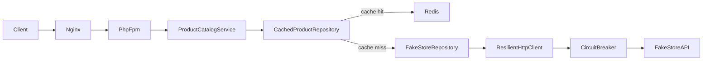

# Scalability, Infrastructure & Performance Architecture

This document describes how the Product Catalogue application scales from thousands to millions of users, which patterns are used, and how to run the Docker stack locally.

## Scale path (1k → 1M+ users)

| Stage | Users (approx.) | Architecture |
|-------|-----------------|--------------|
| Starter | 1k | Single Docker stack: nginx, 1× PHP-FPM, Horizon, MySQL, Redis |
| Growth | 10k–100k | Horizontally scale PHP-FPM replicas; Redis ElastiCache; RDS MySQL; ALB |
| Enterprise | 1M+ | CloudFront CDN for static assets; read replicas; MSK/Kafka event bus; OpenSearch; multiple worker fleets |

The application tier remains **stateless**: any web node can serve any request when session, cache, and queue backends are shared.

## Stateless checklist

Use [`.env.docker.example`](../.env.docker.example) in production-like environments:

- `SESSION_DRIVER=redis` — no sticky sessions
- `CACHE_STORE=redis` — shared catalog cache (Cache Aside)
- `QUEUE_CONNECTION=redis` — async enquiry processing
- Same `APP_KEY` on every app instance
- Database: MySQL (not per-node SQLite)
- Built frontend assets in the image (`public/build`) — no per-node Vite dev server

See [`config/stateless.php`](../config/stateless.php) for the canonical list.

## Pattern map

| Pattern | Implementation |
|---------|----------------|
| Cache Aside | [`CachedProductRepository`](../app/Repositories/CachedProductRepository.php) |
| Circuit Breaker | [`CircuitBreaker`](../app/Infrastructure/Resilience/CircuitBreaker.php) + [`ResilientHttpClient`](../app/Infrastructure/Resilience/ResilientHttpClient.php) |
| Bulkhead | Horizon supervisors: `catalog`, `enquiries`, `default` ([`config/horizon.php`](../config/horizon.php)) |
| Adapter | [`MessageBusInterface`](../app/Infrastructure/Contracts/MessageBusInterface.php), [`SearchIndexInterface`](../app/Infrastructure/Contracts/SearchIndexInterface.php) |
| CQRS | [`SubmitEnquiryHandler`](../app/Enquiries/Commands/SubmitEnquiryHandler.php) + catalog service reads |
| Repository / Service | Tickets 1–2 |
| Queue-based processing | Enquiry listeners on `enquiries` queue |

## Request flow (catalog read)



When the circuit is **open** or the upstream fails, `CachedProductRepository` serves **stale** cached data when available (Cache Aside fallback).

## API rate limiting

- Limiters: `api` (default) and `api_strict` in [`config/rate_limiting.php`](../config/rate_limiting.php)
- Registered in [`AppServiceProvider`](../app/Providers/AppServiceProvider.php)
- Applied to `/api/*` via `throttleApi` in [`bootstrap/app.php`](../bootstrap/app.php)
- Production uses Redis-backed throttling; tests use the array cache driver

## Queue bulkhead (Horizon)

| Supervisor | Queue | Purpose |
|------------|-------|---------|
| `catalog-supervisor` | `catalog` | Future catalog warmers / indexing |
| `enquiries-supervisor` | `enquiries` | Enquiry emails, audit, analytics |
| `default-supervisor` | `default` | General jobs |

Run workers:

```bash
php artisan horizon
```

Dashboard: `/horizon` (allowed in `local`/`testing` or when `HORIZON_DASHBOARD_OPEN=true`).

> Horizon requires `pcntl` and `posix` (Linux/Docker). On Windows host, run Horizon inside Docker only.

## Future adapters (Kafka, RabbitMQ, OpenSearch)

Configured in [`config/infrastructure.php`](../config/infrastructure.php):

| `MESSAGE_BUS` | Adapter |
|---------------|---------|
| `laravel_queue` (default) | Log-only publish hook |
| `redis_log` | Redis/log sink |
| `kafka` | Stub — set `KAFKA_ENABLED=true` when wiring MSK |
| `rabbitmq` | Stub — set `RABBITMQ_ENABLED=true` |

| `SEARCH_DRIVER` | Adapter |
|-----------------|---------|
| `null` (default) | No-op |
| `opensearch` | Stub — set `OPENSEARCH_ENABLED=true` |

Swap drivers via env without changing domain code (Adapter pattern).

## Docker deployment

### Prerequisites

- Docker Desktop (Windows/macOS) or Docker Engine (Linux)
- Copy environment file:

```bash
cp .env.docker.example .env.docker
php artisan key:generate --show   # paste APP_KEY into .env.docker
```

### Start stack

```bash
docker compose --env-file .env.docker up --build -d
```

Open http://localhost:8080

Services: `nginx`, `app` (PHP-FPM), `mysql`, `redis`, `horizon`, `scheduler`.

### Horizontal scaling

```bash
docker compose -f docker-compose.yml -f docker-compose.scale.yml up --build --scale app=3 -d
```

The scale override swaps nginx to [`docker/nginx/default.scale.conf`](../docker/nginx/default.scale.conf) with Docker DNS resolution for multiple `app` tasks.

## Future AWS mapping (documentation only)

| Component | AWS service |
|-----------|-------------|
| Static assets | CloudFront + S3 |
| Load balancing | ALB → ECS/EKS services |
| PHP workers | ECS/EKS tasks (stateless) |
| Cache + queue | ElastiCache Redis |
| Database | RDS MySQL (+ read replicas) |
| Event bus | MSK (Kafka) via `KafkaMessageBusAdapter` |
| Search | Amazon OpenSearch via `OpenSearchAdapter` |

No Terraform/ECS manifests are included in this repository; adapters and env keys are the integration points.

## Observability

- Health: `GET /up` (Laravel built-in)
- Horizon metrics: `/horizon`
- Logs: `LOG_CHANNEL=stderr` in Docker
- Audit / analytics tables for enquiry events (Ticket 2)

## Local development (non-Docker)

- XAMPP/Windows: Redis for cache/queue; run `php artisan queue:work redis` if not using Horizon on Windows
- Use `.env.example` for SQLite + database sessions on a single machine
